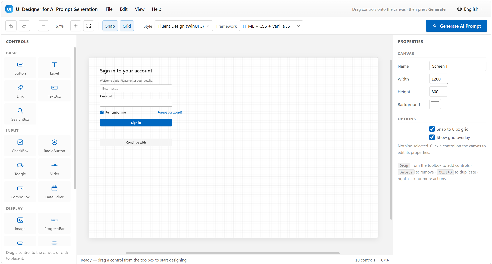

# UI Designer for AI Prompt Generation

A **single-file**, zero-dependency UI prototyping tool that turns your drag-and-drop design into a ready-to-use **AI prompt** — paste it into any AI chat and get production-ready UI code for your chosen framework and design style.

Everything lives in one HTML file. No build step, no install, no server required.

[Online experience](https://lightlytech.github.io/UI-Designer-for-AI-Prompt-Generation/)

## Highlights

- **Desktop interface** with a menu bar, toolbar, toolbox, canvas, and properties panel — fully in English and 9 other languages.
- **Left toolbox** — 20 controls across 5 categories (Basic, Input, Display, Containers, Data): buttons, labels, links, text boxes, search boxes, checkboxes, radio buttons, toggles, sliders, combo boxes, date pickers, images, progress bars, badges, dividers, panels, cards, data grids, and list views.
- **Center canvas** — drag controls from the toolbox, move them, resize them with 8 handles, snap to an 8 px grid, zoom from 25 % to 300 %, and toggle a grid overlay.
- **Right properties panel** — edit name, text, position, size, font size, colors, corner radius, border, opacity, alignment, bold/italic, plus per-control properties (slider range, progress value, checked state, combo items, grid columns, image URL, …).
- **Generate AI Prompt** — one click produces a structured English prompt describing the screen size and every control's exact position, size, and styling, ready to paste into ChatGPT, Claude, Gemini, Copilot, or any other AI assistant.

## Design styles

Fluent Design (WinUI 3) · Material Design 3 · Apple Human Interface · Ant Design 5 · Bootstrap 5 · Modern SaaS (Tailwind) · Neumorphism · Glassmorphism · Flat Minimal · Skeuomorphic · Cyberpunk Neon · Corporate Enterprise · Retro Pixel · Warm Minimalism

## Target frameworks

HTML + CSS + Vanilla JS · React (JSX) · React + Tailwind · Vue 3 · Angular · Svelte · WPF (XAML) · WinForms · UWP · WinUI 3 · .NET MAUI · Avalonia UI · Flutter · SwiftUI · Jetpack Compose · Qt/QML · Tkinter · Java Swing · Electron + React

## Usage

1. Download [`AI-UI-Designer.html`](AI-UI-Designer.html).
2. Double-click it (or open it in any modern browser). That's it — no server or dependencies.
3. Drag controls onto the canvas and arrange them.
4. Pick a **Design style** and **Target framework** in the toolbar.
5. Click **Generate AI Prompt**, then **Copy Prompt**.
6. Paste the prompt into your AI chat and let it generate the code.

> The prompt is always generated in English so the AI produces the best possible code, regardless of the interface language.

## Keyboard shortcuts

| Shortcut | Action |
| --- | --- |
| `Delete` / `Backspace` | Delete selected control |
| `Ctrl` + `Z` | Undo |
| `Ctrl` + `Y` | Redo |
| `Ctrl` + `D` | Duplicate selected control |
| `Ctrl` + `S` | Save project to the browser (localStorage) |
| Arrow keys | Move by 1 px (`Shift` = 8 px) |
| Right-click | Context menu (duplicate, delete, z-order) |
| `Esc` | Deselect / close dialog |

## Languages

English · 简体中文 · 日本語 · 한국어 · Español · Français · Deutsch · Русский · Português · Italiano — switch via the 🌐 button in the title bar. The choice is remembered per browser.

## Project features

- **File menu** — new design, save/load project (localStorage), import/export design as JSON.
- **Edit menu** — full undo/redo history.
- **View menu** — zoom in/out, actual size, fit to screen, snap and grid toggles.
- Ships with a preloaded sign-in screen example so you can try the workflow immediately.

## Browser support

Latest versions of Chrome, Edge, Firefox, and Safari. The app uses standard DOM APIs only — no frameworks, no polyfills, no network access.

## License

MIT — free to use, modify, and share.
